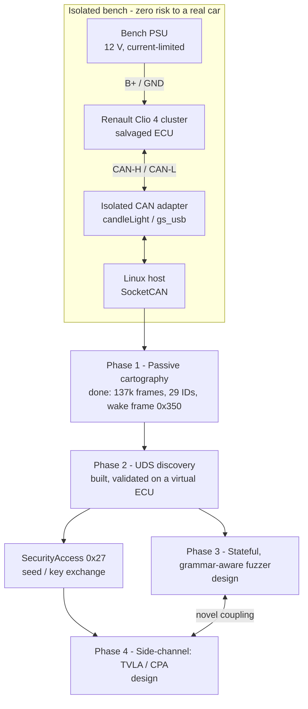

# VULCAN

**Automotive cybersecurity research bench - CAN / UDS on a salvaged Renault Clio 4 instrument cluster.**

A static, isolated desk bench for diagnostic-protocol security research: all the value of
live CAN/UDS work, **zero risk** to a real vehicle. The research goal is to couple a
**stateful, grammar-aware UDS fuzzer** with **side-channel analysis of the SecurityAccess
(0x27) service** - a largely unexplored intersection, aimed at venues like ESCAR and
Pwn2Own Automotive.

> Defensive security research on **owned, salvaged hardware**, conducted responsibly.
> Any genuine vulnerability in a shipping product is handled via coordinated disclosure.
> See `PROJECT.md §4` for the non-negotiable safety & ethics rules.

---

## How it fits together



---

## Current status

Phases 0-1 are **done on the bench and against a real donor vehicle**; the Phase 2 UDS
toolchain is **built and validated on a virtual ECU**, ready to point at the cluster the
moment it is woken.

| Phase | Scope | State |
|---|---|---|
| **0** | Bench bring-up: connector decode, safe power-up, `can0`, bitrate | **done** |
| **1** | Passive CAN cartography + capture of the cluster's wake stimulus | **done** |
| **2** | UDS discovery: sessions (0x10), DID sweep (0x22), NRC map, detect 0x27 | **built & validated on `vcan0`** (live run pending bench wake) |
| **3** | Stateful, grammar-aware UDS fuzzer (core contribution) | design (`src/fuzzer/`) |
| **4** | Side-channel-guided SecurityAccess (novel) | design (`sidechannel/`) |

**Known blocker (documented, with a fix in flight):** the bench cluster is a
*partial-networking* node - it ignores arbitrary CAN frames until it receives its specific
Renault wake-up frame, and a single CAN adapter cannot cleanly transmit it to a non-ACKing
node. Fix: a second identical adapter to ACK the replay. Until then, Phase 2 runs against a
virtual ECU. Full debugging trail in `lab-notebook/2026-08-12` and `2026-09-04`.

---

## Concrete results so far

- **Reverse-engineered the 24-pin cluster connector** with a multimeter - no public pinout
  exists. Confirmed the +12 V rail (pins 3/16/17/20), GND (pin 15), and the CAN pair
  (pins 23/24, measured **120.4 Ω** internal termination). -> `docs/pinout.md`
- **Safe, current-limited power-up** (12.0 V / ~2 A / OCP): healthy **30 mA** standby draw,
  no fault, stable. -> `lab-notebook/2026-08-12`
- **Characterized the cluster as partial-networking** via an exhaustive, documented negative
  result - both CAN orientations, every common bitrate, and all candidate +APC pins tested;
  none wake it. (A clean negative result, methodically reached.)
- **Captured the wake sequence** from a donor Clio 4 at the OBD port in **100 % passive
  listen-only** mode, and identified **`0x350`** (10 Hz, rolling counter on byte 0) as the
  network-management / wake frame - it is blasted ~16x on an otherwise-silent bus *before*
  every other node cascades online. -> `lab-notebook/2026-09-04`
- **Cartography tool** (`src/mapping/cartography.py`, standard library only): parsed
  **137,458 frames** into **29 distinct IDs**, each profiled by rate, DLC, and per-byte
  activity (static / counter / live-signal). -> full table in `docs/phase1-cartography.md`
- **Full UDS client + discovery suite** (`src/uds/`): ISO-TP transport, DiagnosticSessionControl,
  service probing (safe bare-SID), DID sweep, SecurityAccess seed request - plus a **virtual
  ECU** so the whole pipeline is validated end-to-end on `vcan0` **with no hardware**.

---

## Run it yourself (no hardware needed)

The entire Phase 2 discovery pipeline runs against a virtual ECU on a virtual CAN bus:

```bash
# one-time setup (Linux / WSL2): can-utils + a venv with python-can, can-isotp, cantools
bash src/bringup/wsl_setup.sh
source ~/.venvs/vulcan/bin/activate

bash src/bringup/vcan_up.sh                        # create virtual bus vcan0
python -m src.uds.sim_ecu --channel vcan0 &        # virtual UDS ECU
python -m src.uds.discovery --channel vcan0 --find # discover it end-to-end
```

Expected: discovery finds the ECU (`0x7E0 -> 0x7E8`), lists supported services, reads the
identification DIDs, flags a security-locked DID, and receives a SecurityAccess (0x27) seed.

---

## Stack & standards

**Python** (`python-can`, `can-isotp`, `cantools`), **SocketCAN** / `can-utils`,
Linux (WSL2), candleLight/`gs_usb` isolated CAN adapter, bench PSU + multimeter.
Standards: **ISO 11898** (CAN), **ISO 15765-2** (ISO-TP), **ISO 14229** (UDS).

## Repository layout

```
PROJECT.md     project handbook - read first (safety rules §4 are non-negotiable)
config/        bus.yaml - single source of truth (interface, bitrate, arbitration IDs)
docs/          RESEARCH.md (annotated bibliography), pinout.md, bench-setup.md
src/bringup/   SocketCAN + virtual-bus bring-up, bitrate scan, sanity check
src/mapping/   Phase 1 passive cartography
src/uds/       Phase 2 UDS client, discovery, virtual ECU
src/fuzzer/    Phase 3 stateful/grammar-aware fuzzer (design)
sidechannel/   Phase 4 ChipWhisperer + TVLA (design)
lab-notebook/  dated experiment logs - documentation-first
captures/      raw candump logs (gitignored - may contain vehicle-identifying data)
```

## Documentation

This project is **documentation-first**: every experiment is a dated entry in
`lab-notebook/` (hypothesis, commands, observations, raw-log path), and `docs/RESEARCH.md`
grounds each technique in the literature. The research framing - and where the VULCAN
contribution is novel - is in `docs/RESEARCH.md §6`.
